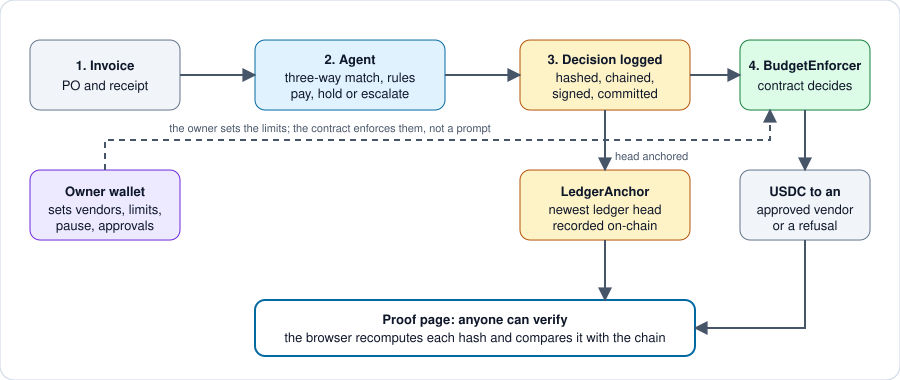

<p align="center"></p>

# CeedeBooks

*An autonomous accounts-payable agent for African SMEs, on Arc. "Ceede" means money in Pulaar/Fulfulde.*


CeedeBooks checks each invoice against a purchase order and an independently confirmed receipt, then pays, holds or escalates it. Spending limits are enforced by a smart contract, never by a prompt, and every decision is hash-logged before money moves.

Most small businesses pay bills from a spreadsheet, a chat thread and a bank app. With CeedeBooks the owner keeps control of the money, and anyone can check what the agent did.

## How it works

<p align="center"></p>

- The agent proposes; the contract decides. A wrong or manipulated agent is refused on-chain.
- The decision hash is committed in an earlier block than the payment, so "reasoned before paid" is provable.
- Each business has its own contract, agent wallet and signed, hash-chained ledger.

## What is live

| | |
|---|---|
| Proof page (public, no login) | [ceedebooks.xyz](https://ceedebooks.xyz) |
| API (public audit routes need no key) | [api.ceedebooks.xyz](https://api.ceedebooks.xyz) |
| Admin site (wallet sign-in) | [admin.ceedebooks.xyz](https://admin.ceedebooks.xyz) |
| Vendor portal and business registration | [portal.ceedebooks.xyz](https://portal.ceedebooks.xyz), [registration](https://portal.ceedebooks.xyz/business.html) |
| Agent manifest | [`/.well-known/agent.json`](https://api.ceedebooks.xyz/.well-known/agent.json) |
| Status | **v1.3.3.3**, running on Arc Testnet with test USDC. Details: [status](docs/status.md) |

Everything runs on testnet. Two businesses exist and both are ours; no outside business or paying user yet. The limits are in the [trust model](docs/trust-model.md).

## Quick start

No wallet needed.

1. Open [ceedebooks.xyz](https://ceedebooks.xyz). You see live paid, held and escalated counts and a feed of decisions.
2. Press **Verify** on any decision. Your browser recomputes the hash and compares it with the event on Arc.
3. Or check from a terminal. Expect `verified: true` and `onchain.match: true`:
   ```bash
   curl -s https://api.ceedebooks.xyz/decisions/46f65d7786a368e6e0814c938b8af9a7f6bed20bb1196478ac0a32708fa6f14a/verify
   ```
4. Run it yourself (see [Setup](#setup)), then `forge test -vv` and `python -m pytest agent/tests -q`.

## Verified results

| What | Result |
|---|---|
| Foundry tests | 111 passing |
| Python tests | 766 passing |
| Node suites | 6 runs passing, CI on every push |
| Live payment, Arc Testnet | 2.20 USDC, verified on-chain: [evidence](docs/evidence.md) |
| Contract refusal, Arc Testnet | an unapproved vendor refused, anchored on-chain: [record](docs/rollouts/2026-10-15-red-team.md) |
| Milestone escrow, Arc Testnet | 0.1 USDC released by the agent, 0.5 USDC by the approver: [record](docs/rollouts/2026-10-28-escrow-release-live.md) |
| Earned-vendor autopay, Arc Testnet | one 0.01 USDC payment without a click: [record](docs/rollouts/2026-11-07-autopay-live.md) |

All live proofs, with transaction links: [evidence](docs/evidence.md).

## Where the sponsor technology is used

| Integration | Where | Evidence |
|---|---|---|
| Arc Testnet, spending contract | [`contracts/BudgetEnforcer.sol`](contracts/BudgetEnforcer.sol), [`BudgetEnforcerV2.sol`](contracts/BudgetEnforcerV2.sol), [`BudgetFactory.sol`](contracts/BudgetFactory.sol) | [domain payment](docs/rollouts/2026-10-02-domain-payment.md) |
| Arc Testnet, ledger anchor and escrow | [`contracts/LedgerAnchor.sol`](contracts/LedgerAnchor.sol), [`MilestoneEscrow.sol`](contracts/MilestoneEscrow.sol) | [anchor](docs/rollouts/2026-10-12-first-ledger-anchor.md), [escrow](docs/rollouts/2026-10-28-escrow-release-live.md) |
| Circle developer-controlled wallets | [`agent/wallet_setup.py`](agent/wallet_setup.py), [`agent/contract.py`](agent/contract.py) | every payment in [evidence](docs/evidence.md) |
| Circle Gateway | [`agent/gateway.py`](agent/gateway.py), [`scripts/gateway_deposit.py`](scripts/gateway_deposit.py) | [deposit](docs/rollouts/2026-10-15-gateway-deposit.md) |
| USDC on Arc | [`agent/contract.py`](agent/contract.py), [`agent/config.py`](agent/config.py) | [architecture](docs/architecture.md) |

### Contracts (Arc Testnet)

| Contract | Address |
|---|---|
| BudgetEnforcer (v1, original business) | [`0x47D8a05a0d31aFA492A9F4A37A8991ED4aa683fB`](https://explorer.testnet.arc.io/address/0x47D8a05a0d31aFA492A9F4A37A8991ED4aa683fB) |
| BudgetFactory | [`0x97b9A3802bA6B258cBeF6070532a265656bb391C`](https://explorer.testnet.arc.io/address/0x97b9A3802bA6B258cBeF6070532a265656bb391C) |
| LedgerAnchor | [`0x008217BeC86462E76126F94e50eBe68fb4a41444`](https://explorer.testnet.arc.io/address/0x008217BeC86462E76126F94e50eBe68fb4a41444) |
| BudgetEnforcerV2, test business `ceedebooks-test-v1282` | [`0x030512Cd974F9A282415B0e6C81465f31502e32C`](https://explorer.testnet.arc.io/address/0x030512Cd974F9A282415B0e6C81465f31502e32C) |
| MilestoneEscrow (reference deployment, source not verified) | [`0x9752F995739C8A171AbD24944925EaF4d2971dd5`](https://explorer.testnet.arc.io/address/0x9752F995739C8A171AbD24944925EaF4d2971dd5) |

What each contract does: [contracts](docs/contracts.md).

## Security

- Only owner-approved vendors can be paid, within per-payment, daily, per-category and weekly limits, once per invoice.
- A payment needs a decision committed in an earlier block.
- The agent cannot withdraw funds, add vendors, change limits or pause; those belong to the owner wallet.
- Every decision is hash-chained and signed per business, and the ledger head is anchored on-chain.
- The model writes narrative and a recorded second opinion; the rules decide.
- Maker-checker on releases, and a pause with a public reason.

What is and is not guaranteed: [trust model and limits](docs/trust-model.md).

## Setup

```bash
git clone https://github.com/MusaAis/CeedeBooks
cd CeedeBooks
cp .env.example .env   # fill in real values

pip install -r agent/requirements.txt
git clone --depth 1 https://github.com/foundry-rs/forge-std lib/forge-std   # test library, git-ignored
python3 scripts/ledger_key.py new --env .env   # the API refuses to start without a ledger signing key; the seed is never printed

set -a; source .env; set +a
uvicorn backend.main:app   # one worker only
```

Set `ARC_TESTNET_RPC_URL` to an Arc Testnet RPC endpoint. Circle wallet and contract steps: [setup and deploy](docs/setup-and-deploy.md). Test counts and how to run each suite: [testing](docs/testing.md).

## Documentation

| | |
|---|---|
| [Features](docs/features.md), [How it works](docs/how-it-works.md) | What is built and how a payment happens |
| [Architecture](docs/architecture.md), [Trust model](docs/trust-model.md) | Design, guarantees and limits |
| [Contracts](docs/contracts.md), [API](docs/api.md) | Contract behaviour and every route |
| [Status](docs/status.md), [Evidence](docs/evidence.md), [Traction](docs/traction.md) | Latest releases and what ran live |
| [Since Sep 27](docs/HACKATHON.md) | What changed during the hackathon |
| [Changelog](CHANGELOG.md), [Roadmap](docs/roadmap.md), [Known issues](docs/known-issues.md) | History, plans, documented bugs |
| [Testing](docs/testing.md), [Project structure](docs/project-structure.md), [Server upgrades](deploy/DEPLOY.md) | For contributors and operators |

## Roadmap

- Idle-cash yield through a pooled wrapper contract, and EURC payments to European vendors
- Agent-to-agent invoicing with a reference vendor client
- PDF and email intake, a Telegram bot and webhooks

Phase by phase: [roadmap](docs/roadmap.md).

## Built with

Python, FastAPI, SQLite, Solidity 0.8.20 with Foundry, web3.py, Circle developer-controlled wallets and Gateway, Arc Testnet, plain JavaScript front ends. Boilerplate and libraries: [forge-std](https://github.com/foundry-rs/forge-std), and the packages in [`agent/requirements.txt`](agent/requirements.txt). The contracts are written for this project.

Built during the Tameion Agents Hackathon (Canteen × Circle × Arc), Sep 27 – Oct 17, 2026, and developed since.

## Builder

**Musa Ali**, CS student at Federal University Dutse (FUD). Builder, PenTester & Dev. Appointed **Lepton Peer Mentor** by Canteen.

- **3rd** place at Lepton, **Standout** at Agora with [@AgoraFX](https://github.com/MusaAis/AgoraFX)
- X: [@Musa_Ais](https://x.com/Musa_Ais), GitHub: [@MusaAis](https://github.com/MusaAis)

## License

MIT
